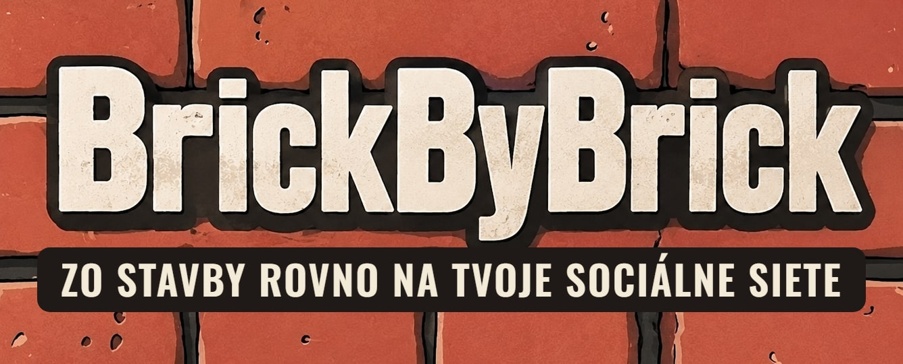
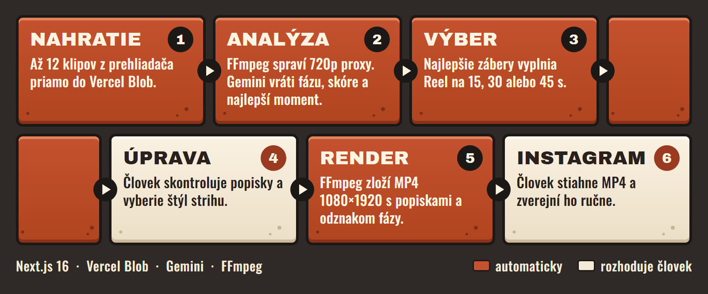

<p align="center">
  
</p>

Stavbárom sa v telefónoch hromadia klipy zo stavby, no málokto má čas strihať z nich videá. BrickByBrick z nich spraví Instagram Reel na výšku, s popiskami po slovensky a odznakom fázy stavby. Zverejnenie ostáva na človeku.

Appka vznikla za jeden deň na hackathone v novembri 2026.

## Ako to funguje

<p align="center">
  
</p>

## Čo sa s ňou dá robiť

- **Výber záberov.** Gemini pozrie prvú minútu každého klipu a určí fázu stavby, skóre záberu a najlepších 3 až 6 sekúnd.
- **Reel na mieru.** Dĺžka 15, 30 alebo 45 sekúnd, štyri štýly strihu, popisky dole, v strede alebo vypnuté.
- **Popis na Instagram.** Gemini pripraví text s hashtagmi na skopírovanie.
- **Stavby a denník.** Každá stavba má svoje hotové Reely a stavbársky denník.
- **Návod na natáčanie.** Appka priamo radí, čo a ako nakrútiť.

## Technické riešenie

| Vrstva | Riešenie |
|---|---|
| Appka | Next.js 16, React 19, TypeScript |
| Úložisko | Vercel Blob, klipy idú z prehliadača priamo a obídu limit funkcie 4,5 MB |
| AI | Gemini cez `@google/genai`, odpoveď kontroluje Zod schéma |
| Video | `ffmpeg-static` vo Vercel funkcii, výstup 1080×1920 H.264 |
| Prístup | Basic Auth v `proxy.ts` |

Kde začať čítať kód:

- [`web/lib/plan.ts`](web/lib/plan.ts) vyberá zábery a rozdeľuje čas Reelu.
- [`web/lib/ffmpeg.ts`](web/lib/ffmpeg.ts) robí proxy a render, klipy kóduje po jednom, aby sa zmestil do pamäte funkcie.
- [`web/lib/overlay.tsx`](web/lib/overlay.tsx) kreslí text do priehľadných PNG, lebo Linuxový build `ffmpeg-static` nemá filter `drawtext`.

## Bezpečnosť a limity

Stránky si môže pozrieť ktokoľvek. Každý zápis a celé `/api/*` vyžaduje heslo, a keď heslo nie je nastavené, nedostane sa dnu nikto. Server spracuje iba klipy z vlastného Blob úložiska a FFmpeg číta len bežné video formáty, takže požiadavka ho nevie poslať na cudziu adresu.

Pred ostrým použitím treba počítať s týmito limitmi:

- Automatické vyraďovanie klipov so ŠPZ, cudzími tvárami, adresami alebo deťmi táto verzia nemá, takže obsah musí skontrolovať človek.
- Blob úložisko je verejné. Kto pozná adresu súboru, otvorí ho, a nespracované klipy ostanú uložené, ak sa render nedokončí.
- Render musí stihnúť limit Vercel funkcie 300 sekúnd, preto Reel nemá možnosť 60 sekúnd.

## Spustenie

```bash
cd web
npm install
npm run dev
```

Do súboru `web/.env.local` patria tieto hodnoty:

```bash
GEMINI_API_KEY=
BLOB_READ_WRITE_TOKEN=
DEMO_PASSWORD=
# voliteľné, predvolený model je gemini-3.5-flash-lite
GEMINI_MODEL_VLM=
```

Testy spustíš cez `npm test`. Pokrývajú plán Reelu, heslo a kontrolu adries klipov. Overené na Node.js 24.
